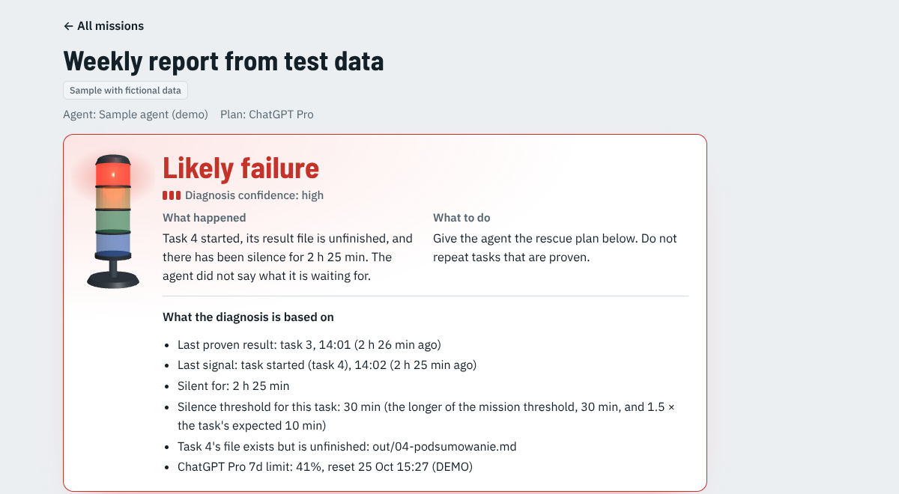
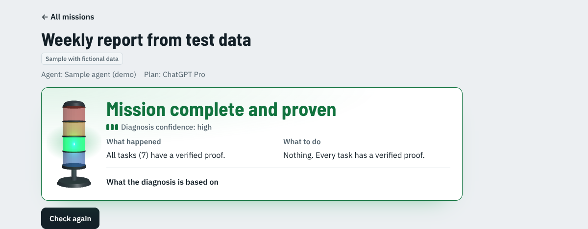
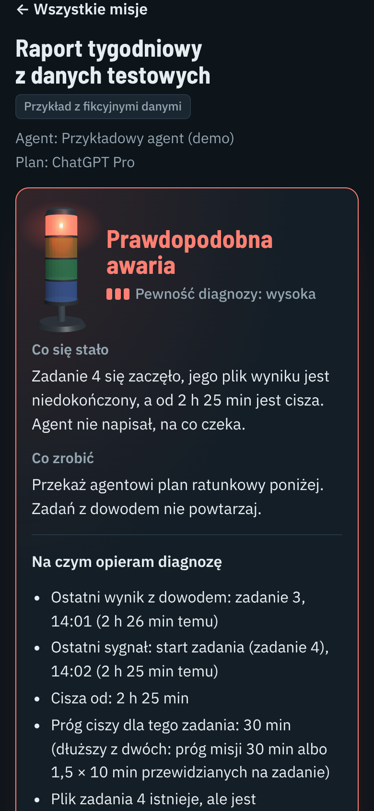

# Mission Rescue: Agent Proof & Recovery

**The truth about an AI agent's mission: what is really done (with proof), why it stopped, and how to resume it safely. Green only with proof.**

[Polski opis niżej](#po-polsku) · Live demo: **https://daniel221287.github.io/mission-rescue/** · MIT licence

Demo video (2:30, English subtitles): https://www.youtube.com/watch?v=qmY8n-7ZRvM · Devpost: https://devpost.com/software/mission-rescue-agent-proof-recovery



An agent promises to do a mission from A to Z, finishes part of it, then goes quiet. Mission Rescue reads the agent's own files, checks every result instead of trusting the agent's word, says why the work stopped and how sure it is, and writes a safe plan to finish the mission without repeating what is already done.

## Try it in one minute (no install)

1. Open **https://daniel221287.github.io/mission-rescue/** (phone or computer). The page follows your browser's language (Polish or English); the **PL/EN** button in the top corner switches it.
2. Open **Weekly report from test data**. It is red: 3 of 7 tasks are proven, task 4 left a half-written file, and the agent has been silent for over two hours.
3. Read **What happened**, **What to do** and the **Rescue plan** (last confirmed checkpoint, what to check first, what to do next). **Copy the instruction** gives the text you would hand to your agent.
4. Press **Run the sample agent**: it really computes tasks 4 to 7 from fictional data and writes each result with its SHA-256 fingerprint. Then press **Check again**: **7 of 7 proven**, green.
5. Press **Honesty test** (it silently changes one number in task 3's file) and **Check again**: red, *fingerprint mismatch*. The file's condition still passes; only the fingerprint catches it.

The other samples show every other kind of stop: waiting for a limit, waiting for you (with the agent's question), no progress (heartbeats only), undetermined (low confidence), normal work, an outside effect waiting for your confirmation, and a broken mission file.



## Run it on your computer

Needs [Node.js](https://nodejs.org) 20 or newer. No packages to install.

```
git clone https://github.com/Daniel221287/mission-rescue.git
cd mission-rescue
node tools/server.mjs --open
```

On Windows you can double-click **START.cmd** instead. The page opens at `http://127.0.0.1:4317/app/` (if that port is busy: `node tools/server.mjs --port 4318 --open`). On first start the sample missions are written to `missions/`; the page reads that folder through a small read-only local program (it serves files, it never changes them). There the page opens on **This computer**, the `missions/` folder: drive its sample mission with the command-line demo below, or switch to **Sample missions** for the in-page **Run the sample agent** and **Honesty test** buttons.

The same demo from the command line (the output is in Polish by default; `--lang en` switches it to English):

```
node tools/mission-rescue.mjs demo-reset                                      # write the sample missions to missions/ (the local program also does it on its first start)
node tools/mission-rescue.mjs check missions/weekly-report --lang en          # red: exit code 1
node tools/mission-rescue.mjs demo-agent missions/weekly-report --lang en     # the sample agent finishes tasks 4-7
node tools/mission-rescue.mjs check missions/weekly-report --lang en          # complete: exit code 0
node tools/mission-rescue.mjs honesty-test missions/weekly-report --lang en   # silently change task 3's file
node tools/mission-rescue.mjs check missions/weekly-report --lang en          # proof problem: exit code 1
node tools/mission-rescue.mjs demo-reset                                      # back to the start
```

`check` exits with 0 only when the mission is complete and proven (1: not complete, 2: unreadable), so it can guard a script or a CI step. Run the tests with `node --test` (57 tests: proof levels, every stop verdict, the rescue plan, red to green to red in memory and on disk, resumed tasks and agent clocks, limits labels, the status-line capture, the picked-folder sources, the local program's safety).

You can also open your own missions folder in the page (**Picked folder**, Chrome or Edge on a computer): the browser reads the files, read-only, and nothing is uploaded.

## How it decides

**Four proof levels for every task.** 1. *Declared*: the agent logged "done" with the result file and its SHA-256. 2. *File exists*. 3. *Verified*: the fingerprint matches and the mission's condition passes (contains a text, a JSON value equals the expected one, or not empty). 4. *Outside effect* (only for tasks like "send the offer"): no file can prove the outside world, so a person confirms it, tied to that exact file version. A task is green only when every level that applies is met; a file that exists but was never declared is an *uncertain effect*, never green.

**Silence is not automatically a failure.** The waiting time grows with the task (the longer of the mission's threshold, default 30 min, and 1.5 × the task's expected time), and a task started again (a retry or a rescue) is timed from its latest start. Heartbeats, notes and "still working" messages are signs of life, not progress. If the agent's times run ahead of the computer's clock (a wrong time zone), the verdict says it cannot judge the silence instead of guessing. Verdicts: likely failure, no progress, waiting for a limit, waiting for you, waiting for your confirmation, working, undetermined, proof problem, complete. Each comes with the concrete reason, the facts used and a confidence level (high, medium, low).

**Rescue without blind repeats.** The plan names the last confirmed checkpoint, the tasks not to repeat, the tasks to *check first* (their effect is uncertain: if the result is already there, report it instead of doing it again), the tasks to redo, the tasks to do, and what only a person can confirm. You hand the instruction to your agent; Mission Rescue never runs agents.

**Limits, labelled by where the numbers come from:** DEMO, MANUAL (typed in the page), AUTOMATICALLY VERIFIED (captured from Claude Code's official status line by `tools/claude-statusline.mjs`, fresh for 30 minutes) and OUT OF DATE. Demo numbers explain the sample missions only and never decide anything about your own missions. Mission Rescue never logs in to chat sites to read limits.

## Connect your own agent

A mission is a folder with `mission.json` (the tasks, each with its result file and condition) and `worklog.jsonl` (one line per event, written by the agent). See **[docs/AGENT_PROTOCOL.md](docs/AGENT_PROTOCOL.md)** for the format, a ready instruction to paste into your agent, and how to compute SHA-256 on Windows, macOS and Linux.

## Privacy and safety

- Reads files only on your device: the built-in samples, the local read-only program, or a folder you pick. The page is not allowed to send data anywhere (Content Security Policy `connect-src 'self'`).
- The local program listens only on `127.0.0.1`, answers only requests addressed to this computer (so another website cannot reach it through DNS rebinding) and never follows a link out of its folders.
- Never edits mission files, never runs agents, never logs in anywhere. The sample agent and the honesty test work only on the sample mission.
- Human confirmations and manual limits stay in your browser.
- Zero cost: no paid services, no API keys.

## Built with

Plain JavaScript modules shared by the page and Node.js (no build step, no runtime packages), Web Crypto SHA-256, [three.js](https://threejs.org) 0.160.0 (MIT) for the signal tower, and the fonts Barlow Semi Condensed, IBM Plex Sans and IBM Plex Mono (SIL Open Font License), all saved in the repository ([third-party notices](THIRD_PARTY_NOTICES.md)). Built by Daniel during Devpost Learn *Build With AI: Basics*, with Claude as the coding agent; the plan, requirements and build log are in [`devpost/`](devpost/).

---

## Po polsku

**Prawda o pracy agenta AI: co jest naprawdę zrobione (z dowodem), dlaczego stanęło i jak bezpiecznie wznowić misję. Zielone tylko z dowodem.**

Agent obiecuje misję od A do Z, kończy tylko część, a potem cichnie. Mission Rescue czyta pliki agenta, sprawdza każdy wynik zamiast wierzyć na słowo, mówi, dlaczego praca stanęła i jak pewna jest ta diagnoza, i pisze bezpieczny plan dokończenia misji bez powtarzania tego, co już zrobione.



### Sprawdź w minutę (bez instalacji)

1. Otwórz **https://daniel221287.github.io/mission-rescue/** na telefonie albo komputerze.
2. Otwórz **Raport tygodniowy z danych testowych**: czerwone, 3 z 7 zadań z dowodem, zadanie 4 zostawiło niedokończony plik, od ponad 2 godzin cisza.
3. Przeczytaj **Co się stało**, **Co zrobić** i **Plan ratunkowy**. **Kopiuj instrukcję** daje tekst do przekazania agentowi.
4. **Uruchom przykładowego agenta** (naprawdę liczy zadania 4–7 i zapisuje je z odciskami SHA-256), potem **Sprawdź ponownie**: **7 z 7, zielone**.
5. **Test uczciwości** (po cichu zmienia jedną sumę w pliku zadania 3) i **Sprawdź ponownie**: czerwone, *odcisk się nie zgadza*.

Pozostałe przykłady pokazują inne zatrzymania: czeka na limit, czeka na Ciebie (z pytaniem agenta), brak postępu, stan nieustalony, normalna praca, efekt zewnętrzny do Twojego potwierdzenia i zepsuty plik misji.

### Na swoim komputerze

Potrzebny [Node.js](https://nodejs.org) 20 lub nowszy, nic więcej. Pobierz repozytorium i uruchom **START.cmd** (Windows) albo `node tools/server.mjs --open`. Strona otworzy się pod `http://127.0.0.1:4317/app/`, a przykładowe misje trafią do folderu `missions/`. Te same kroki w wierszu poleceń są w części angielskiej wyżej (`demo-reset`, `check`, `demo-agent`, `honesty-test`); tam mają `--lang en`, a bez tej opcji wynik jest po polsku.

### Jak to działa w skrócie

- **Cztery poziomy dowodu:** zgłoszone, plik istnieje, zweryfikowany (odcisk SHA-256 i warunek), efekt zewnętrzny potwierdzony przez człowieka.
- **Cisza to nie automatycznie awaria:** próg rośnie z długością zadania, wznowione zadanie liczy się od nowego startu, sygnały „żyję” to nie postęp, każda diagnoza ma powód, fakty i pewność.
- **Plan ratunkowy:** ostatni potwierdzony punkt, czego nie powtarzać, co najpierw sprawdzić, co zrobić, co potwierdza człowiek. Instrukcję przekazujesz agentowi sam.
- **Limity z etykietą źródła:** DEMO (tylko dla przykładów), RĘCZNE, ZWERYFIKOWANE AUTOMATYCZNIE (pasek stanu Claude Code), NIEAKTUALNE. Bez logowania do czatów.
- **Prywatność:** tylko odczyt plików na Twoim urządzeniu, nic nie jest wysyłane, lokalny program odpowiada tylko temu komputerowi, zero kosztów.

Format misji i gotowa instrukcja dla agenta (po polsku i angielsku): **[docs/AGENT_PROTOCOL.md](docs/AGENT_PROTOCOL.md)**. Licencja MIT.

Film demo (2:30, napisy po angielsku): https://www.youtube.com/watch?v=qmY8n-7ZRvM · Zgłoszenie na Devpost: https://devpost.com/software/mission-rescue-agent-proof-recovery
